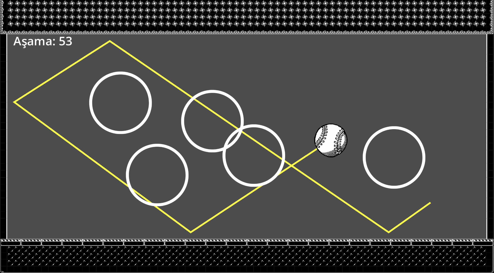
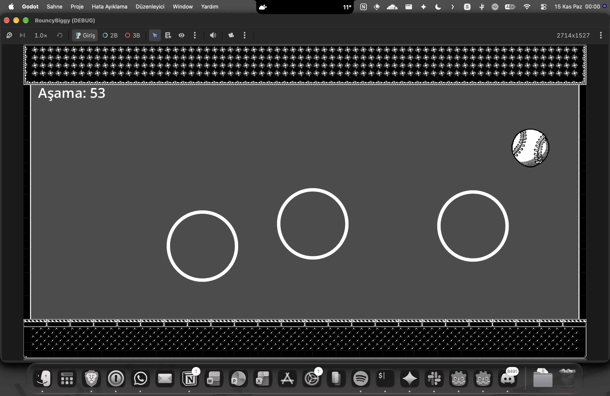
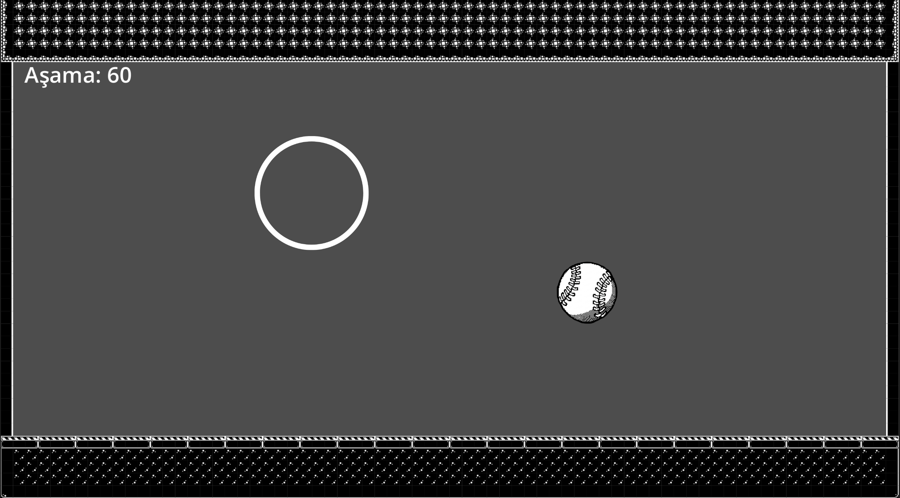
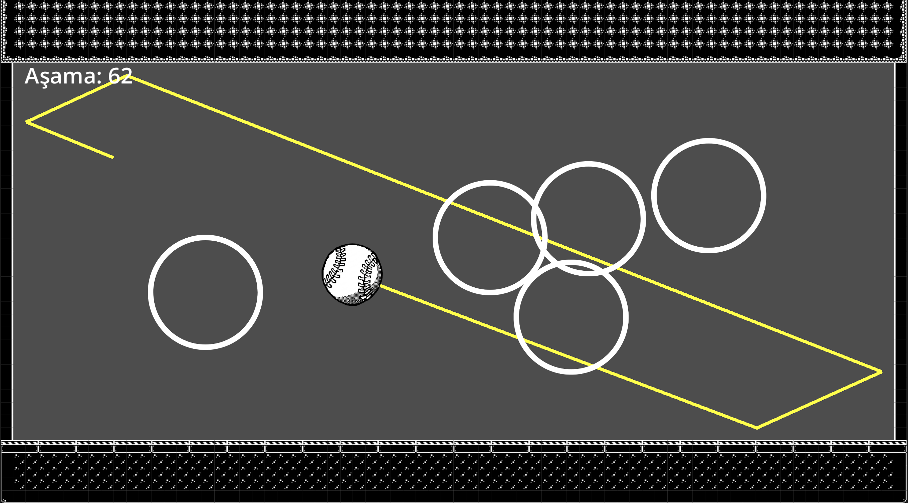
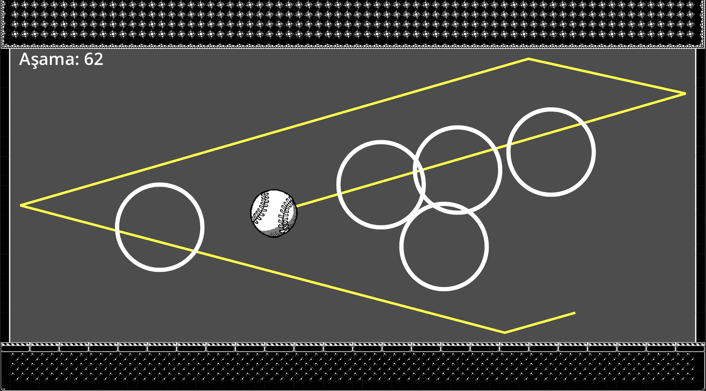
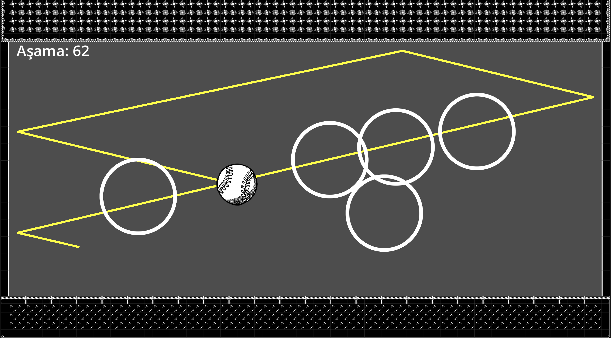

# BouncyBiggy ⚾️

Take control of Biggy in this fast-paced, physics-based game. Your goal is simple yet challenging: bounce your way through an endless series of procedurally generated holes. Every miss is just a setup for a comeback, so master your momentum, adapt to unpredictable gaps, and keep bouncing back to beat your best.

### 🛠️ Resources and Tools We’ve Used:
- **Coding the Physical System and Scoreboard System:** Claude Sonnet 5.5
- **Cover and Icons:** Canva, Inkscape, [Pixelart](https://www.pixilart.com)
- **Sound Effectsi:** [sfxr.me](https://sfxr.me)
- **Ball Assets:** [Game Developer Studio - Balls](https://gamedeveloperstudio.itch.io/balls)
- **UI (Assets:** [Kenney - 1-bit Platformer Pack](https://kenney-assets.itch.io/1-bit-platformer-pack)

## Link to the Game:
[itch.io](https://ozanelon.itch.io/bouncybiggy)

## Screenshots

### Playing Footages

